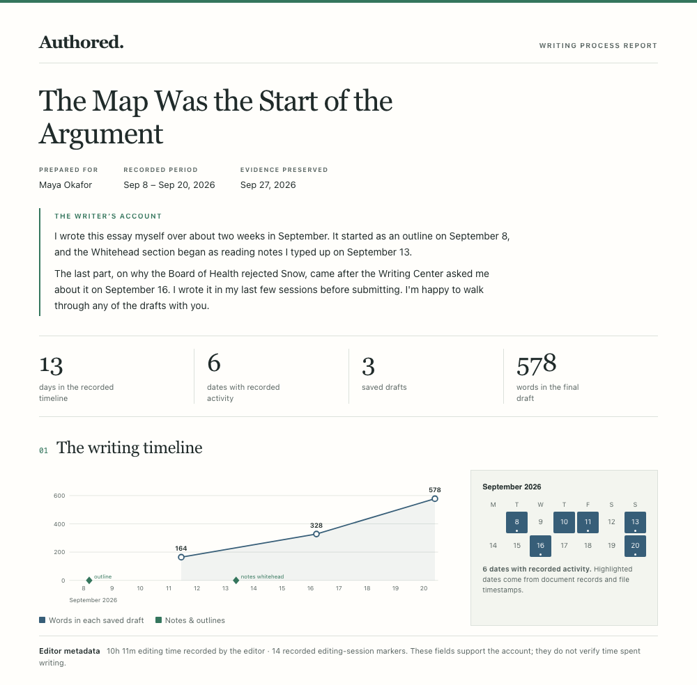
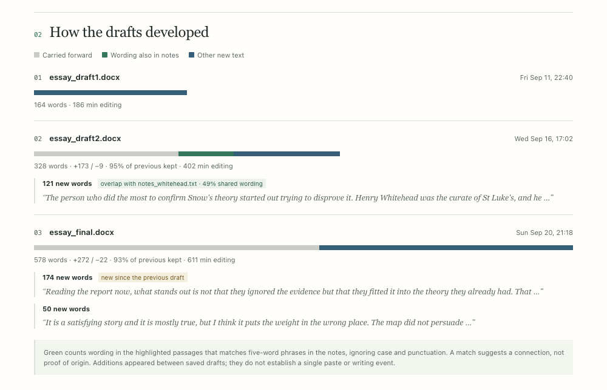

# Authored

**Prove you wrote it.** An agent skill for Codex and Claude that helps writers respond when an AI detector flags work they wrote themselves.

It's the opposite of a humanizer: instead of disguising text, it shows the work behind it.



## The idea

| An AI detector sees | Authored shows your reviewer |
|---|---|
| One finished document | Every draft, and how each one grew |
| A probability score | 13 recorded days, three drafts, notes and editor metadata |
| Text that "looks like AI" | The notes and outline each passage came from |
| Nothing it can verify | Fingerprinted files anyone can check |

Detectors misfire on formal, plain and second-language writing, and the companies behind them say their scores shouldn't be the sole basis for a decision. What settles most cases is the writing process itself. Authored finds it, preserves it and builds a readable report.

## Try it

**Codex** — install for your user account:

```bash
mkdir -p ~/.agents/skills
git clone https://github.com/forrestelliott/authored ~/.agents/skills/authored
```

In Codex CLI or the IDE extension, select Authored with `/skills` or mention `$authored` in your prompt. If it does not appear, restart Codex. For a project-only installation, use `.agents/skills/authored` inside that project instead. See the [official skill documentation](https://learn.chatgpt.com/docs/build-skills#where-codex-loads-local-skills).

**Claude Code** — install for your user account:

```bash
git clone https://github.com/forrestelliott/authored ~/.claude/skills/authored
```

Then tell your assistant what happened (prefix with `$authored` in Codex to select it explicitly):

> Turnitin flagged my history essay as 68% AI and my professor wants to meet Thursday. My drafts and notes are in ~/Documents/history-essay.

The skill guides your assistant to:

1. **Preserve** your files in a read-only, fingerprinted archive before anything changes.
2. **Reconstruct** the timeline from the dates and editing records inside your documents.
3. **Build the report** above, plus a short reply to your reviewer, written to sound like you.
4. **Rehearse** the meeting by asking the questions a skeptical reviewer would ask about your work.

Using the Claude apps instead? Download this repo as a zip and upload it under Settings → Capabilities → Skills.

## Every draft, at a glance



Grey is text carried over from the previous draft. Green counts wording in the highlighted new passages that also appears in your notes. Blue is the remaining new text. These matches suggest connections to discuss, not proof of where a passage came from. Large additions between saved drafts are often what reviewers ask about, so Authored highlights them for you to explain.

Only have a Google Doc? Its version history is excellent evidence. Authored walks you through capturing it with screenshots and replying to a client or teacher.

## What it won't do

- **Rewrite your text to get past detectors.** Changing a flagged document looks like tampering and wipes out your best evidence.
- **Fake, backdate or edit evidence.** That turns a false accusation into real misconduct.
- **Pretend you didn't use AI if you did.** It helps you describe what you used, accurately, against your actual policy.

It isn't legal advice. If the stakes are high, bring in your student advocate, ombudsperson, union rep or a lawyer too.

<details>
<summary><b>Under the hood</b></summary>

Standard-library Python 3.9+. No network calls. Your files are only read, never changed.

```bash
python3 scripts/snapshot.py ~/Documents/history-essay --out ~/Documents/essay-evidence
python3 scripts/report.py ~/Documents/essay-evidence --title "My essay" --writer "Your Name" --summary summary.txt
```

| File | What it does |
|---|---|
| `scripts/snapshot.py` | Read-only copies, SHA-256 fingerprints, original timestamps |
| `scripts/report.py` | The printable report ([HTML](docs/example-report.html), [PDF](docs/example-report.pdf)) |
| `scripts/timeline.py` | Full chronology: file dates, Word editing time and sessions, tracked changes, comments, PDF dates, git commits |
| `scripts/draft_diff.py` | Draft-to-draft changes and where new passages came from |
| `references/evidence-sources.md` | Where writing history lives in Google Docs, Word, Pages, Scrivener, Notion, LMSs and more |
| `references/detector-limits.md` | Checked sources on detector reliability, and how to cite them honestly |
| `references/appeal-playbook.md` | How to reply to a teacher, integrity office, employer, client or editor |
| `evals/` | Test cases and the fictional evidence folder behind the screenshots |

</details>

## Privacy

Run directly on your machine, the Python scripts process files locally and make no network calls. When you use Authored through Codex, Claude or another assistant, any text, excerpts and tool results the assistant reads are processed by your configured model provider under its data policies. Cloud sessions and uploaded evidence are processed in the host service's environment. Review your host's privacy settings; installing a local skill does not make the assistant an offline service. See [Claude Code's data usage documentation](https://code.claude.com/docs/en/data-usage).

Authored advises against pasting unpublished work into online detectors, some of which keep what you submit.

## Development checks

Run the script regression tests with Python 3.9+:

```bash
python3 -m unittest discover -s tests -v
```

The scenarios in `evals/evals.json` separately describe expected assistant behavior; they are not automated script tests. See [Codex compatibility checks](docs/codex-compatibility.md) for the tested scope.

## License

MIT
